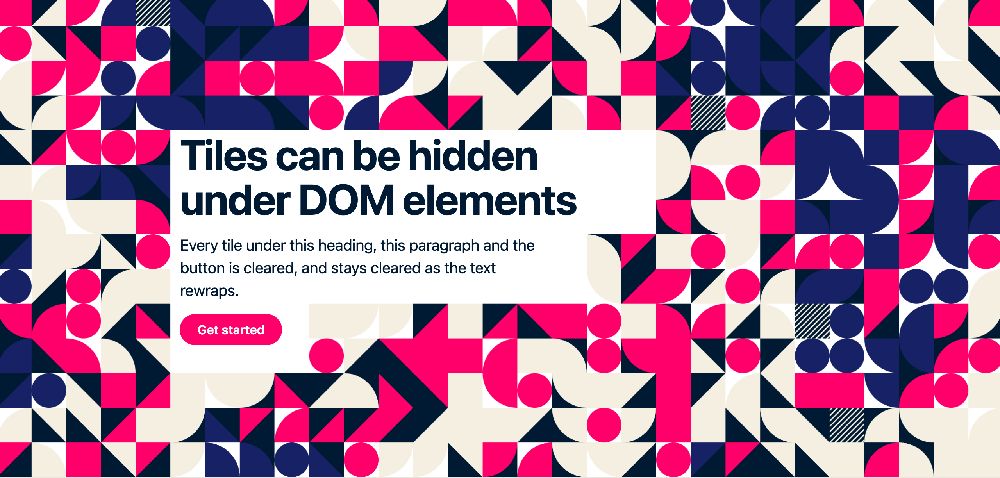
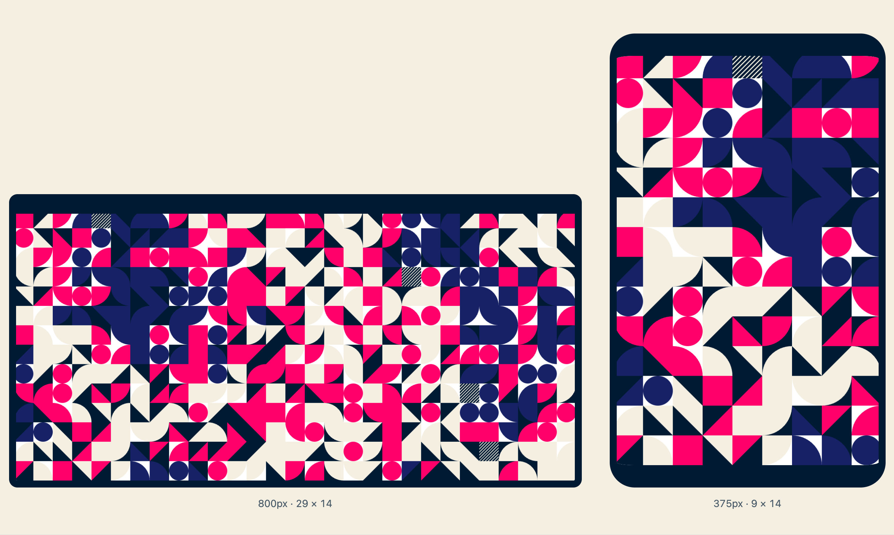
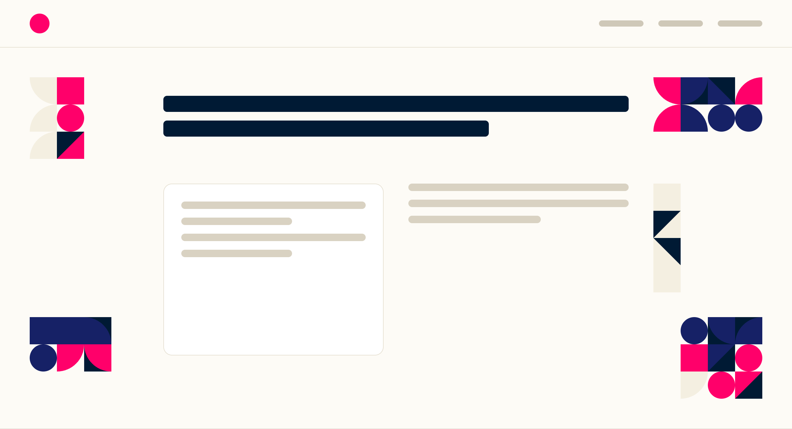

# gen-tilesets

Procedural tilesets for the web: a deterministic generator, and a renderer that draws its output in
any page, with or without Svelte.


You design a tileset in the [editor](https://gen-tilesets-editor.vercel.app): which tiles exist,
and the rules that place, rotate, scale and fade them across a grid. You export it as a zip, and
this package draws it in your page. The same file and the same seed always produce the same picture,
on any machine. The tileset scales with its container, can change its shape at breakpoints, and can
keep clear of the text laid over it.

## Install

```sh
npm install @vit-foundation/gen-tilesets
```

Pin an exact version: the package is `0.x`, and a minor version may change the generated output.
`svelte@^5.20` is an optional peer dependency, needed only for the Svelte components.

## Usage

The editor exports `tileset.zip`, which holds `tileset.json` and a `tiles/` folder of images. Serve
`tiles/` as it is, keeping its internal structure. Then load the JSON with `loadTilesetFile`, which
upgrades and validates it and throws if the file is invalid, and render it.

### Vanilla JS

```js
import { loadTilesetFile } from "@vit-foundation/gen-tilesets";
import { TilesetRenderer } from "@vit-foundation/gen-tilesets/render";

const file = loadTilesetFile(await (await fetch("/tileset.json")).json());
const renderer = new TilesetRenderer(document.querySelector("#hero"), { file });

renderer.update({ options: { seed: "another" } }); // change anything later
renderer.destroy();                                  // remove everything it added
```

The renderer injects its own stylesheet, so there is nothing else to include. The same class works
in Observable Framework, and a React or Vue wrapper around it is about ten lines. See
[Without Svelte](https://github.com/fndvit/gen-tilesets/blob/main/apps/docs/src/content/docs/guides/without-svelte.md).

### Svelte

```svelte
<script>
  import { loadTilesetFile } from "@vit-foundation/gen-tilesets";
  import Tileset from "@vit-foundation/gen-tilesets/Tileset.svelte";
  import raw from "./tileset.json";

  const file = loadTilesetFile(raw);
</script>

<Tileset {file} />
```

`<Tileset>` takes the same `file` and `options` as `TilesetRenderer`. Its width comes from its parent,
and it reserves its own height.

### Where the images go

Image paths in `tileset.json` are relative (`tiles/water/a1.svg`). On any page other than the site
root, anchor them with `prefixedProvider`, or the browser looks for them under the page's own path:

| Setup | `tiles/` goes in | Provider |
| --- | --- | --- |
| SvelteKit | `static/tiles/` | `prefixedProvider(base)`, with `base` from `$app/paths` |
| Vite | `public/tiles/` | `prefixedProvider(import.meta.env.BASE_URL)` |
| Plain HTML | next to the page's root | `prefixedProvider("/")` |

```js
import { prefixedProvider } from "@vit-foundation/gen-tilesets/render";

const options = { provider: prefixedProvider(base) };
```

A missing image is never replaced. Its cell stays empty, and `options.onAssetError` reports it.
→ [Getting started](https://github.com/fndvit/gen-tilesets/blob/main/apps/docs/src/content/docs/guides/getting-started.md)

## Features

### Deterministic, with variation on request

With no options, the same file always draws the same picture. Pass `seed` to place one file twice
with different pictures, or `loadSalt` to get a new picture on every page load.

### Canvas or DOM

The default `substrate: "canvas"` paints one seamless bitmap. `substrate: "dom"` renders one element
per cell instead, so the tiles are in the server-rendered HTML and each cell can be hit-tested.
→ [Options](https://github.com/fndvit/gen-tilesets/blob/main/apps/docs/src/content/docs/guides/options.md)

### Hosting over content



Name the elements laid over the tileset, and every tile they overlap is hidden. The mask follows the
page's real layout as text rewraps and elements move.

```js
{ avoid: { targets: "h1, p, .cta", padding: 8 } }
```

→ [Hosting over content](https://github.com/fndvit/gen-tilesets/blob/main/apps/docs/src/content/docs/guides/hosting-over-content.md)

### One design, many shapes



A file's rows, columns and cell size can change without a second file. `reshape(file, { rows: 3 })`
reuses a design at another size. Responsive rules, written in the editor or passed in code, change
the shape with the width of the tileset's box.

```json
"responsive": [{ "maxWidth": 500, "columns": 9, "rows": 14 }]
```

→ [One design, many shapes](https://github.com/fndvit/gen-tilesets/blob/main/apps/docs/src/content/docs/guides/responsive.md)

### Decorations



Author one decoration style and place it as small blocks of any size around a page. Each placement
gets its own seed.

```svelte
<TileDecoration {style} rows={3} columns={2} cellSize={44} options={{ seed: "top-left" }} />
```

→ [Decorations](https://github.com/fndvit/gen-tilesets/blob/main/apps/docs/src/content/docs/guides/decorations.md)

## Options

Every setting is a field of one optional `options` object:

| Field | Default | Purpose |
| --- | --- | --- |
| `seed` | the file's `defaultSeed` | A different picture from the same file. |
| `loadSalt` | `0` | A different picture on each load. |
| `substrate` | `"canvas"` | `"dom"` for server-rendered tiles and per-cell hit-testing. |
| `overflow` | `"hidden"` | `"visible"` lets tiles show past the box (`"dom"` only). |
| `sizing` | `"fluid"` | `"fixed"` keeps cells at their pixel size and crops instead of scaling. |
| `align` | `{ x: "center", y: "top" }` | Which side is cropped. |
| `avoid` | off | Elements to keep clear: `{ targets, padding }`. |
| `responsive` | the file's rules | Breakpoint rules that replace the file's. `[]` turns them off. |
| `provider` | `defaultProvider` | How an image path becomes a URL. |
| `onAssetError` | none | Called when an image fails to load. |

The `TilesetOptions` type documents every field. →
[Options](https://github.com/fndvit/gen-tilesets/blob/main/apps/docs/src/content/docs/guides/options.md)

## Documentation

- [Getting started](https://github.com/fndvit/gen-tilesets/blob/main/apps/docs/src/content/docs/guides/getting-started.md): from the editor's export to tiles on screen
- [Options](https://github.com/fndvit/gen-tilesets/blob/main/apps/docs/src/content/docs/guides/options.md): every setting, the two substrates, fixed sizing, sizing with CSS
- [Hosting over content](https://github.com/fndvit/gen-tilesets/blob/main/apps/docs/src/content/docs/guides/hosting-over-content.md)
- [One design, many shapes](https://github.com/fndvit/gen-tilesets/blob/main/apps/docs/src/content/docs/guides/responsive.md): `reshape` and responsive rules
- [Decorations](https://github.com/fndvit/gen-tilesets/blob/main/apps/docs/src/content/docs/guides/decorations.md)
- [Without Svelte](https://github.com/fndvit/gen-tilesets/blob/main/apps/docs/src/content/docs/guides/without-svelte.md): plain JS, Observable Framework, React
- [The engine](https://github.com/fndvit/gen-tilesets/blob/main/apps/docs/src/content/docs/guides/engine.md): `generate()`, cell attributes, and geometry for building tools

## License

MIT
